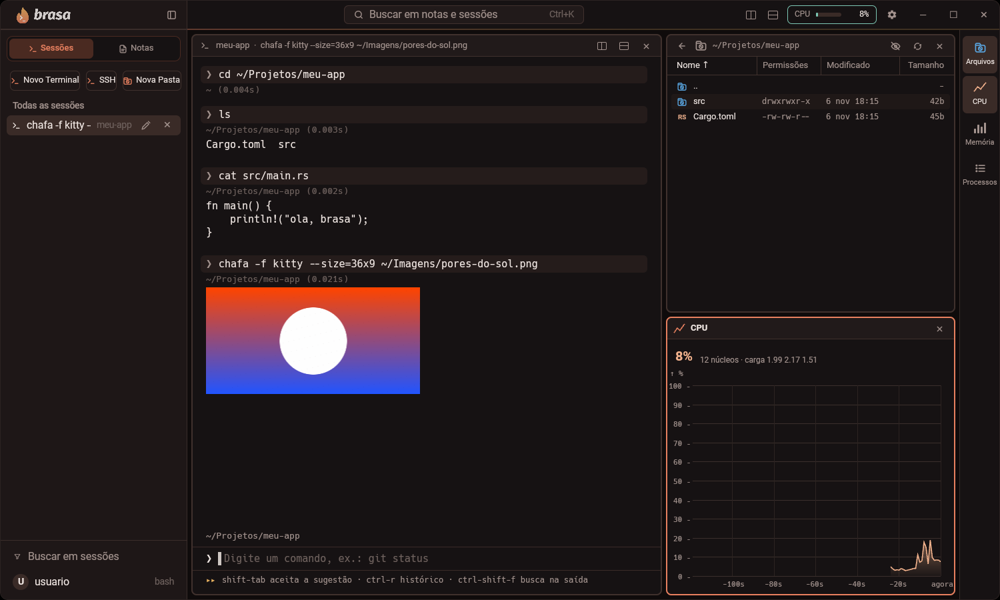

<div align="center">

<picture>
  <source media="(prefers-color-scheme: dark)" srcset="branding/brasa-logo-dark.png">
  
</picture>

**Terminal desktop em Rust com blocos de comando, notas executáveis e gerenciador de arquivos**




</div>

## Por que Brasa

- **Cada comando é um bloco.** Você vê o que rodou, quanto tempo levou, se deu certo, e copia só a saída de que precisa.
- **Notas que executam.** Escreva em Markdown e rode um bloco de código direto no terminal. Use `{{variaveis}}` nos comandos (o Brasa pergunta os valores), rode todos os blocos em sequência (para no primeiro que falhar) e veja a saída da última execução guardada na própria nota.
- **Busca de verdade.** A caixa no topo (`Ctrl+K`) procura de uma vez em notas, pelo nome e pelo texto, e em sessões, pelo nome e pelo que apareceu na saída.
- **Imagens no terminal.** Entende o protocolo gráfico do Kitty: `chafa -f kitty foto.png` (e programas que usam o protocolo) desenham a imagem dentro do bloco, que rola junto com o texto. Só aceita imagem enviada pelo próprio programa (nunca lê arquivo a pedido do terminal) e limita o tamanho.
- **Banco de dados.** O botão **Banco** (barra da direita) abre uma página que ocupa o lugar do terminal, como as Configurações. Ela guarda uma tabela de conexões (PostgreSQL ou arquivo SQLite) com Conectar, Editar e Excluir; a senha é pedida ao conectar e nunca é gravada. Aberto o banco: lista de tabelas, abas Dados (grade paginada e ordenável), Estrutura e Diagrama (tabelas e chaves estrangeiras, arrastáveis), e a **Query** fica fixa embaixo (`Ctrl+Enter` executa; aceita scripts, funções, triggers e transações, e o resultado vira uma aba). A edição é direta, como no DBeaver: dois cliques numa célula, `×` apaga a linha, `+ Linha` cria; nada é gravado até **Aplicar**, que grava tudo numa transação só (ou nada). Dá para marcar uma conexão como somente leitura. Servidor em outra máquina exige TLS, com o certificado conferido (e um arquivo de CA opcional por conexão).
- **SSH em um atalho.** `Ctrl+Shift+H` (ou o botão SSH da barra lateral) lista os hosts do `~/.ssh/config`; Enter abre uma sessão já conectada e com o nome do host. Também aceita `usuario@maquina` digitado.
- **Histórico que aprende.** As sugestões ao digitar pesam o que você mais usa, o que usou há pouco e o que rodou na pasta atual. `Ctrl+R` abre a busca no histórico. Sugere subcomandos e opções de git, cargo, docker, apt e systemctl, e as máquinas do ssh.
- **Sessões organizadas.** Dê nome aos terminais, agrupe em pastas e divida a tela lado a lado.
- **Arquivos e desempenho ao lado.** Gerenciador de arquivos com tamanho das pastas, permissões e visualizador de imagens, e monitor de CPU, memória e processos.
- **Seu jeito.** Troque a cor do tema (o logo acompanha), o fundo, a fonte e o tamanho sem editar arquivos.
- **Leve.** Cerca de 120 MB de memória e perto de 0% de CPU parado, desenhado pela placa de vídeo. Veja os números em [Desempenho](#desempenho).

## Instalação

### Pelo GitHub (recomendado)

Baixe o instalador da versão mais recente na página de [Releases](https://github.com/Wellingtn/brasa/releases/latest).

**.deb** (Ubuntu, Pop!_OS, Debian e derivados):

```bash
sudo apt install ./brasa_*.deb
```

**.rpm** (Fedora e derivados):

```bash
sudo dnf install ./brasa-*.rpm
```

**Flatpak** (qualquer distribuição com Flatpak):

```bash
flatpak install --user ./Brasa-*-x86_64.flatpak
```

Esses dois se atualizam pelo gerenciador do sistema; o botão "Atualizar" do app só aparece no AppImage e no .deb.

**AppImage** (outras distribuições):

```bash
chmod +x Brasa-*-x86_64.AppImage
./Brasa-*-x86_64.AppImage
```

O Brasa desenha pela placa de vídeo e precisa de um driver Vulkan. No Ubuntu e derivados: `sudo apt install mesa-vulkan-drivers`.

### Compilando do código-fonte

Você precisa de [Rust](https://rustup.rs) e de algumas bibliotecas do sistema. No Ubuntu, Pop!_OS e derivados:

```bash
sudo apt install build-essential pkg-config libxkbcommon-dev libwayland-dev libx11-xcb-dev libxcb1-dev libvulkan-dev mesa-vulkan-drivers
```

Depois, clone e rode:

```bash
git clone https://github.com/Wellingtn/brasa.git
cd brasa
cargo run -p brasa --release
```

Para instalar o executável, rode `cargo build -p brasa --release` e copie `target/release/brasa` para uma pasta no seu `PATH`.

Testado no Pop!_OS 24.04 com GNOME 46.

## Configurações

O botão de engrenagem, ao lado do medidor de CPU, abre as configurações na área à direita da barra lateral.

- **Geral:** versão e shell em uso, aviso de nova versão com atualização dentro do próprio app (botão "Atualizar" na barra superior; AppImage e .deb), atalhos de teclado (clique num atalho e aperte o novo), pastas de notas e de configuração, o medidor de latência do teclado e o botão que restaura a aparência padrão.
- **Aparência:** cor do tema (vermelho, azul, verde, roxo, uma cor própria pela roda de matizes ou por hexadecimal), cor de fundo (carvão, preto, grafite ou um hexadecimal), fonte do terminal com busca e tamanho da fonte numa régua, com uma pré-visualização que você pode editar.

As escolhas valem na hora e ficam em `~/.config/brasa`.

## Atalhos principais

| Ação | Atalho |
|---|---|
| Novo terminal | `Ctrl+Shift+T` |
| Dividir lado a lado / embaixo | `Ctrl+Shift+D` / `Ctrl+Shift+B` |
| Mostrar ou esconder a barra lateral | `Ctrl+Shift+E` |
| Mostrar ou esconder as notas | `Ctrl+Shift+N` |
| Desempenho (CPU, memória, processos) | `Ctrl+Shift+M` |
| Buscar na saída | `Ctrl+Shift+F` |
| Buscar em notas e sessões | `Ctrl+K` |
| Buscar no histórico de comandos | `Ctrl+R` |
| Conectar por SSH | `Ctrl+Shift+H` |
| Zoom | `Ctrl+=` / `Ctrl+-` |

## Desempenho

Medido na máquina de desenvolvimento (Pop!_OS 24.04, GNOME 46, Wayland, placa Intel), com o app recém-aberto:

| Medida | Resultado |
|---|---|
| Abrir a janela | cerca de 0,1 s |
| Memória parado | cerca de 119 MB |
| CPU parado | cerca de 0,1% |
| Despejar 100 MB de texto (`cat`) | cerca de 63 MB/s |

Parado, o Brasa só acorda uma vez por segundo, para atualizar o medidor de CPU.

## Desenvolvimento

```bash
cargo test                     # crates leves (pty, markdown, arquivos, sugestões, editor)
cargo test -p brasa --release  # o app (compila o GPUI, demora mais)
```

## Licença

Brasa é software livre, distribuído sob a [GNU AGPL-3.0](LICENSE). Os créditos de ícones, fontes e inspirações estão em [NOTICE.md](NOTICE.md).
